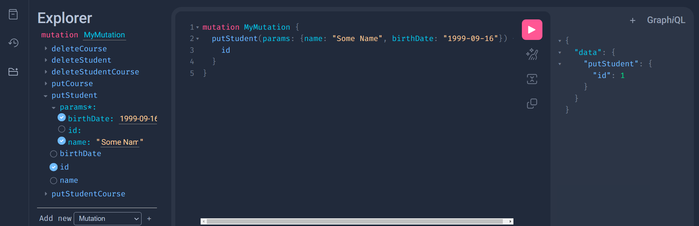
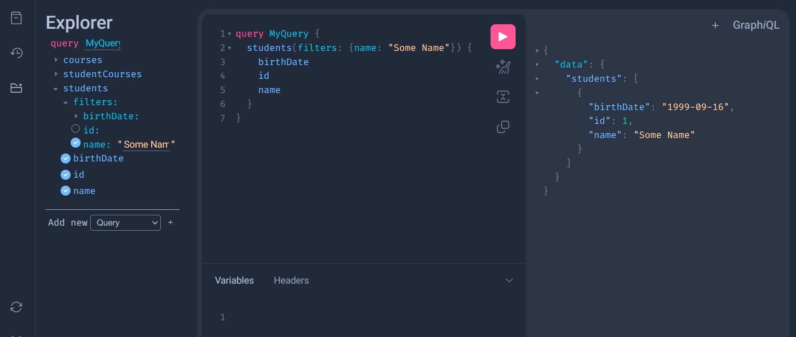

# Getting started


## Let's Code

### File Structure

A common layout is one folder for model classes. This tutorial keeps it minimal: a `models.py` file and a `main.py` file.

### Create some models

First, create classes to represent our database tables.

```Python  
# models.py
{!./examples/tutorial/basic/models.py!}
```

/// note

`GraftModel` inherits `SQLModel`. For more details: [SQLModel](https://sqlmodel.tiangolo.com/).

All parameters of `GraftModel` are documented in the API reference.

///

/// info

To help with imports you can import `Field` from `graftql` (it is re-exported from `sqlmodel`).


///

### Setting a server

Then create a `GraftRouter` and include it in a FastAPI app.

```Python hl_lines="42 52 83-84"
{!./examples/tutorial/basic/main.py!}
```

/// note

`GraftRouter` inherits Strawberry's `GraphQLRouter`. For more details: [Strawberry](https://strawberry.rocks/).

You can pass a dict to `engine` in `GraftRouter` to use multiple databases in the same API. In that case, set `__enginename__` on your `GraftModel` subclasses (default is `'default'`).

All parameters of `GraftRouter` are documented in the API reference.


///


/// info

GraftQL provides an `import_files` helper that imports all model classes from a given folder.


///


## Running

### Start FastAPI

Run `uvicorn main:app` in the project folder and open `localhost:8000/graphql` in your browser to use the Strawberry GraphiQL explorer.

### Run Query

You now have queries plus put and delete mutations for both models.

{ width="800" .center}

Every query comes with a filter argument, so you can filter results by any column.

{ width="800" .center}


/// note

`put` is an upsert: if you pass an `id` that exists, the row is updated; otherwise a new row is created.

///
