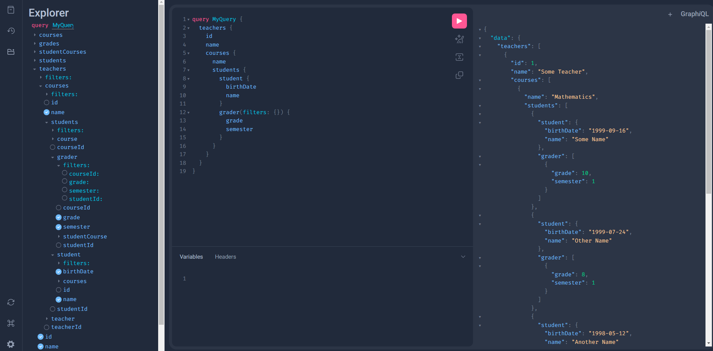

# Relationships

Linking two models is straightforward with GraftQL: declare a `Dl` attribute and specify which fields in the current table map to the related table.

It works much like a foreign key in a conventional database.


```Python  hl_lines="9 19"
{!./examples/tutorial/relationship/models.py[ln:14-32]!}
```

In this case the relationship `Teacher` -> `Course` will be done using field `teacher_id` of `Course` and field `id` of `Teacher`.


/// note

As the relationship `Teacher` -> `Course` is `1 -> N`, in this case we use `list['TargetClass']` as type hint.

///


Source and Target parameters can receive a list too, this is useful when you have tables that need many keys to be linked, for example:

```Python  hl_lines="8-11 20-23"
{!./examples/tutorial/relationship/models.py[ln:48-70]!}
```


/// tip

If you want use a static string or number to make the link between two models, you can pass the string with `_` prefix or the number in `source` and `target`. Ex: `some_field: 'SomeClass' = Dl(source=['some_field', 12, '_staticstring'], target=['target_field', 'month', 'category'])`

Here GraftQL will search for a row of `SomeClass` that has:

 `source_table.some_field` == `target_table.target_field` 

 `target_table.month == 12` 

 `target_table.category == 'staticstring'` 

///

### Run query

Now in our debugger we can see nested schemas


{ width="800" .center}

/// tip

Nested fields have their own filters, which work the same way as the top-level query filters.

///